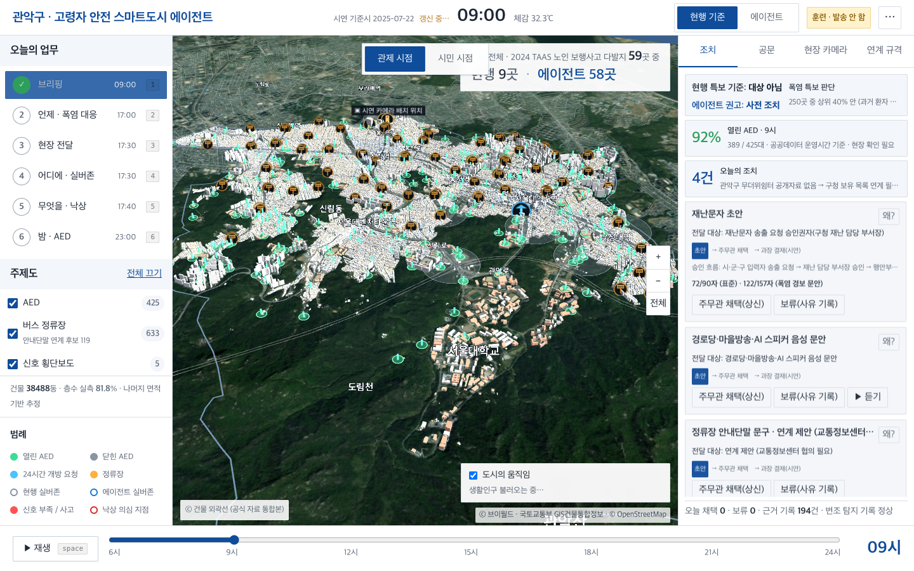
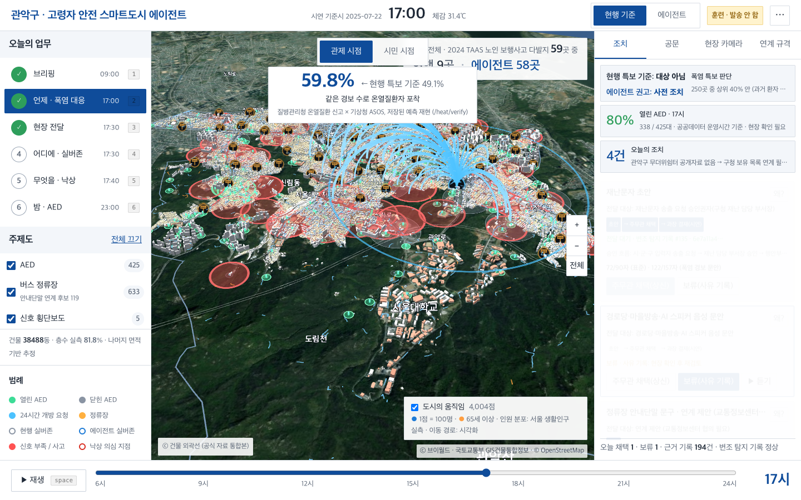
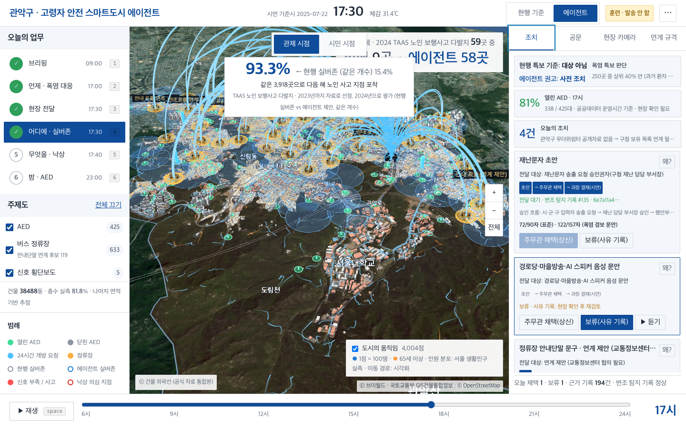
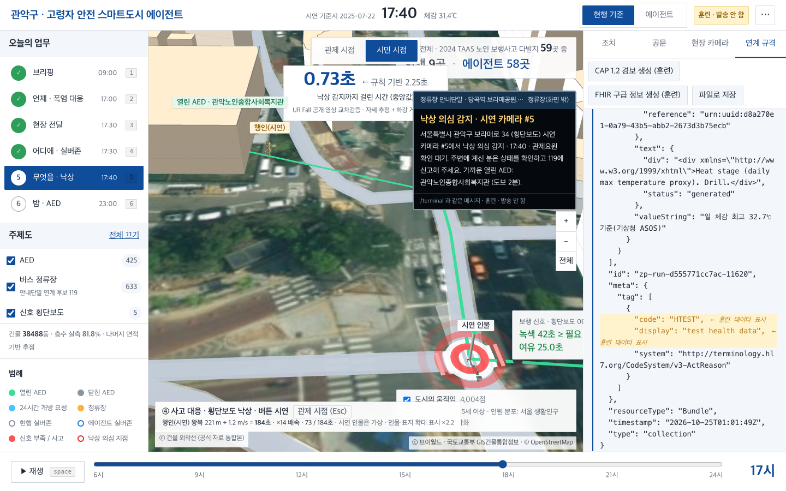
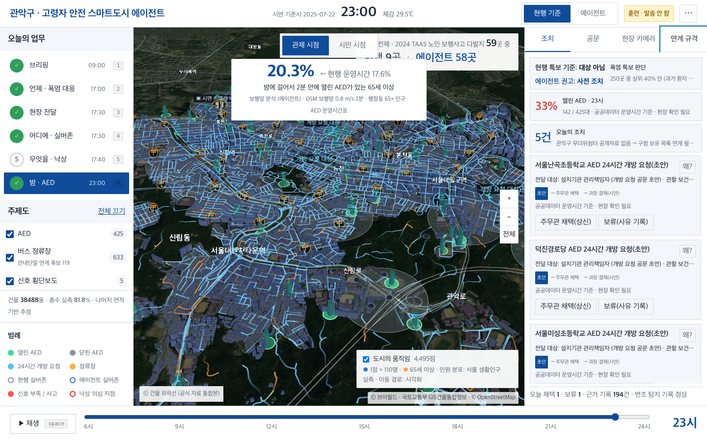
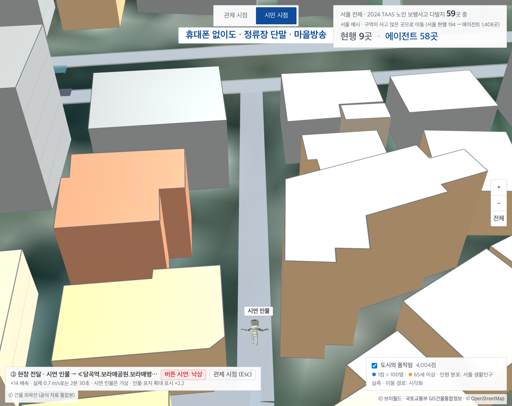
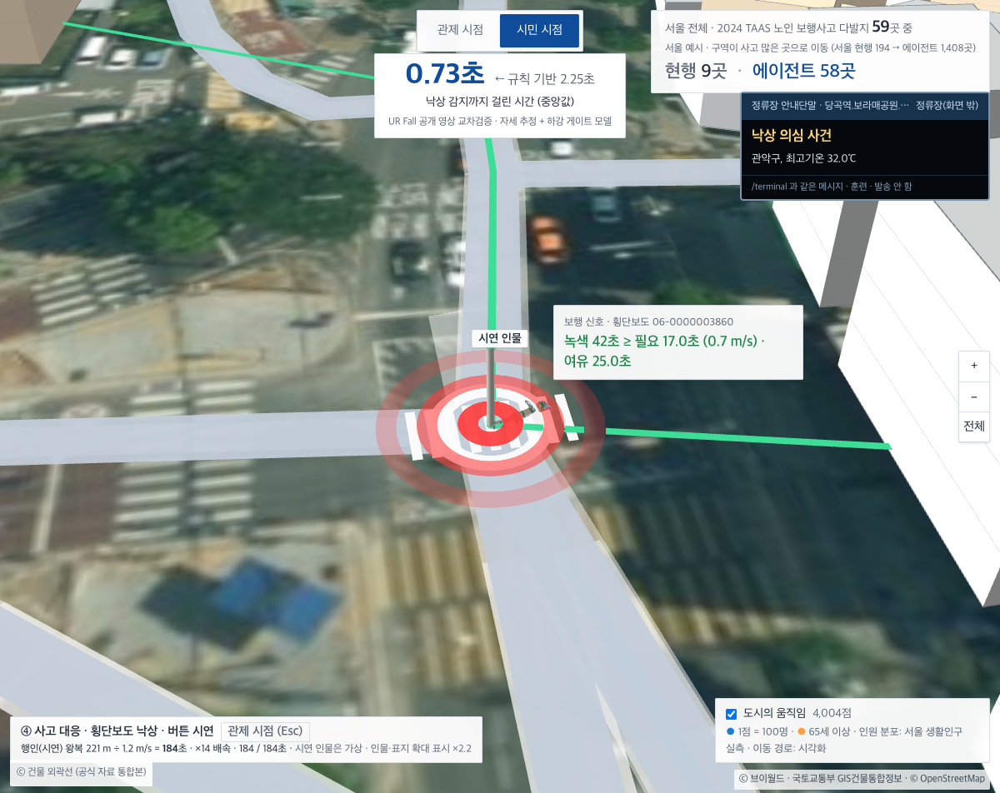
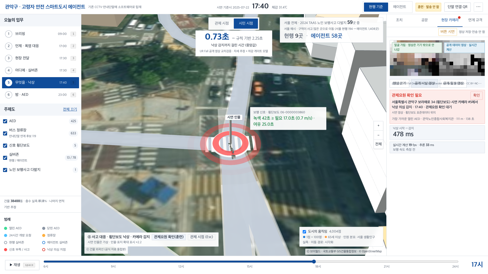

# 고령자 안전 스마트도시 에이전트

**팀 영점** · 강다연 (Dayeon Kang, [@dayeon603-pixel](https://github.com/dayeon603-pixel))

> 기존 CCTV·안내단말·AED 같은 도시 인프라를 고령자 기준으로 다시 배치하고 운영하도록, 공공데이터로 판단하고 담당자가 바로 쓸 수 있는 조치 초안까지 만드는 스마트도시 에이전트입니다. AI는 추천하고, 결정은 사람이 합니다.

## 바로 보기

| | 링크 |
|---|---|
| 실제 웹 시연 (PC는 3D 관제 화면, 휴대폰은 모바일 화면) | https://dayeon603-pixel.github.io/elder-safety-smartcity-agent/ |
| 시연 영상 (약 2분 30초, 자막) | https://dayeon603-pixel.github.io/elder-safety-smartcity-agent/demo.mp4 |
| 휴대폰 재난문자 화면 체험 | https://dayeon603-pixel.github.io/elder-safety-smartcity-agent/#/terminal?view=phone |
| 소스 코드 | https://github.com/dayeon603-pixel/elder-safety-smartcity-agent |

학생 해커톤 작품 시연입니다. 관악구 및 정부기관과 무관하며, 모든 출력은 훈련용으로 실제 발송하지 않습니다.



## 기능 6가지 → 효과 (현행 기준과 같은 조건 비교)

| # | 기능 | 효과 |
|---|---|---|
| 1 | 시군구별 폭염 위험 판단 → 안전안내문자·안내방송 초안 | 같은 경보 수로 온열질환자 포착 **49.1% → 59.8%** (특보 규칙 대비, 2022–2025 통합) |
| 2 | 실버존(노인보호구역) 지정 후보 추천 | 같은 3,918곳으로 다음 해 노인 사고 지점 포함 **15.4% → 93.3%** (2023년까지로 선정, 2024년 평가) |
| 3 | 기존 CCTV 탑재 낙상 감지 → 관제요원 확인 → 119 연계 | 감지 지연 중앙값 **2.25초 → 0.73초** (공개 낙상 영상 교차검증) |
| 4 | 야간 AED 24시간 개방 요청 (거절 시 다음 후보) | 서울 AED 1%(115대) 개방 시 65세 이상 밤 2분 도달 **17.6% → 20.3%** (모형 추정) |
| 5 | 보행신호 연장 협의 요청 초안 | 신호 부족 횡단보도 식별 **3.9% → 41.8%** (1.0 m/s 기준 vs 고령자 0.7 m/s 기준, 7,346곳) |
| 6 | 정류장 안내단말 선정 | 같은 2,000곳으로 폭염 위험 고령자 도보권 **3.6% → 9.5%** (65세 인구순 선정 대비, 같은 목적식으로 최적화) |

수치 출처 파일: `app/backend/experiments/heat/out/results.json`, `silver/out/opt/promoted/coverage_results.csv`,
`fall/results/cv_summary.json`(규칙) · `app/frontend/public/models/fall_cv_summary.json`(배포 모델) · `fall/results/opt/gate/gate_summary.json`,
`walk4/out/opt.json`, `mobility/out/results.json`, `aed/out/summary.json` · `aed/out/replicate_2023.json`.

## 시연

- 공개 시연판: https://dayeon603-pixel.github.io/elder-safety-smartcity-agent/
- 데모 영상: 링크 추가 예정 (시연 흐름: 브리핑 → 폭염 대응 → 현장 전달 → 실버존 재배치 → 낙상 대응 → 야간 AED)

| 폭염 | 실버존 | 낙상 | 밤 AED |
|---|---|---|---|
|  |  |  |  |

| 시민 시점 | 현장 단말 | 공개 낙상 영상 감지 |
|---|---|---|
|  |  |  |

## 구성

| 구성 | 역할 | 위치 |
|---|---|---|
| **현장 에이전트** (CCTV 탑재) | MediaPipe 자세 추정 + 경량 로지스틱 회귀로 낙상 감지. 영상은 기기 안에서만 처리하고 사건 정보만 전송 | `app/frontend/src` (`/field`), `app/backend/experiments/fall` |
| **관제·분석** | 3D 디지털 트윈(관악구 건물 전체), 폭염·실버존·AED 분석, 에이전트가 근거와 함께 조치 초안 작성 (재난문자, CAP 1.2, HL7 FHIR R4, 공문 DOCX). 담당자 채택 전에는 아무것도 발송하지 않음 | `app/backend/app`, `app/frontend/src` (`/twin`, `/app`) |
| **현장 단말** | 버스정류장 안내단말 화면. 큰 글씨, 위험 알림과 가까운 열린 AED 안내 | `app/frontend/src` (`/terminal`) |

## 기술 스택

- 백엔드: Python 3.11+, FastAPI, SQLite, pandas/numpy, lxml (CAP 1.2 XSD 검증), Ollama 로컬 LLM (`qwen2.5:3b` 계획, `qwen2.5vl:3b` 장면 설명)
- 프론트엔드: React 18 + TypeScript, Vite, Tailwind CSS, deck.gl, Recharts, MediaPipe Tasks Vision
- 검증: pytest, Vitest, Playwright (접근성 axe 포함)
- 배포: Docker Compose (backend + nginx)

## 실행 방법

```bash
cd app
make install      # uv sync + npm ci
make env          # .env 생성 (임의 KCF_SECRET_KEY)
make test         # 백엔드 테스트
make demo         # 사전 점검(마이그레이션·데이터·Ollama) → API :8010, 화면 :5190
```

**데이터는 저장소에 포함하지 않았습니다.** 원본 공공데이터 캐시(약 24 GB)는 용량과 각 기관 이용조건 때문에 빠져 있습니다.
아래 공공데이터를 내려받아 `data/cache/`(또는 `KCF_DATA_DIR`)에 두어야 `make demo`, `make heat-eval`, `make modules-load`가 동작합니다.
API 키(공공데이터포털, 기상청 API허브, 브이월드)는 코드나 파일에 넣지 않고 macOS 키체인에서 읽습니다 (`tools/set_key.sh`).
공개 시연판은 `app/frontend/public/`의 가공 데이터만으로 돌아갑니다.

## 사용한 공공데이터

- 질병관리청 온열질환 신고 (2011–2025)
- 기상청 종관기상관측(ASOS) 및 기상특보 (기상청 API허브)
- 행정안전부 주민등록 인구 (2026-09)
- 서울 열린데이터광장 생활인구 (행정동·시간대별)
- 도로교통공단 보행노인 사고다발지 (TAAS)
- 전국 횡단보도 표준데이터 (보행 녹색시간)
- 전국 어린이·노인·장애인 보호구역 표준데이터
- 전국 버스정류장 위치정보
- 국립중앙의료원 전국 자동심장충격기(AED) 정보
- 소방청 구급활동정보
- 지자체 무더위쉼터 (충남·부산)
- 국토교통부 GIS건물통합정보 (브이월드)
- 행정동 경계 (vuski/admdongkor), Meteostat 일별 기온

## 한계

- 낙상 감지 수치는 **실험실 공개 데이터셋**(UR Fall)에서 잰 값입니다. 실제 CCTV 화각·조명·가림에서는 검증하지 않았습니다.
- 모든 경보와 문안은 **훈련 모드**입니다. 재난문자, 119, 안내단말로 실제 발송하는 기능은 없고 시뮬레이터로만 받습니다.
- 관악구는 무더위쉼터 공개 데이터가 없어 쉼터 관련 화면은 구청 보유 목록 연계가 필요하다고 표시합니다.
- 밤 AED 도달률은 운영시간 공공데이터와 도보 모형으로 계산한 **추정치**입니다.

## 라이선스

라이선스: 추후 결정

## 크레딧

- 지도: © OpenStreetMap contributors, Protomaps (ODbL 1.0) — `app/frontend/public/basemap/CREDITS.md`
- 건물: 국토교통부 GIS건물통합정보 (브이월드)
- 3D 인물: Cesium Man © 2017 Cesium, Khronos glTF-Sample-Assets (CC-BY 4.0) — `app/frontend/public/models/CREDITS.md`
- 낙상 영상: UR Fall Detection Dataset, Kwolek & Kepski 2014 (CC BY-NC-SA 4.0) — `app/frontend/public/media/urfall/LICENSE.txt`
- 자세 추정: Google MediaPipe Tasks Vision, pose_landmarker_lite (Apache-2.0)
